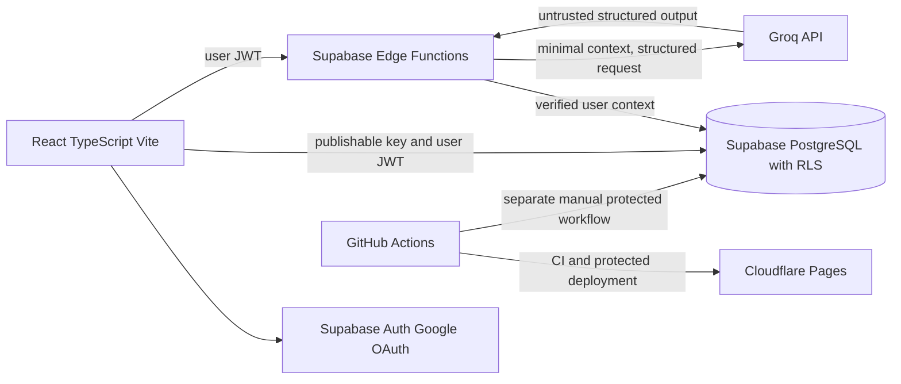

# Architecture and entity relationship design

## Runtime architecture

The browser never calls Groq. The Edge Function validates the Supabase user, derives identity from the verified token, fetches minimal authorized data, validates the model response, and executes only allowlisted operations. SQL and application logic remain authoritative for totals and reports.

## Ownership decision

Existing database relationships include `workspaces.owner_id`, `workspace_members`, `projects.user_id`, and optional `projects.workspace_id`. Tasks, activities, habits, and learning sessions have individual `user_id` ownership. Existing RLS predicates enforce individual ownership; workspace membership currently does not grant access to another owner's projects or records.

Initial Plano Web therefore retains a **hybrid structure with individual ownership as the authorization boundary**. Optional workspace IDs may group a user's own projects. Membership rows are preserved but do not grant collaboration access. New finance records are user-owned and do not receive workspace sharing behavior.

## Logical ERD

The diagram uses logical names. The table below maps existing names to these logical entities; finance and AI entities are proposals. This diagram is not an approved migration.

```mermaid
erDiagram
    AUTH_USERS ||--|| PROFILES : owns
    AUTH_USERS ||--o{ WORKSPACES : owns
    WORKSPACES ||--o{ WORKSPACE_MEMBERS : groups
    AUTH_USERS ||--o{ WORKSPACE_MEMBERS : joins
    AUTH_USERS ||--o{ PROJECTS : owns
    WORKSPACES o|--o{ PROJECTS : groups
    PROJECTS o|--o{ TASKS : groups
    PROJECTS o|--o{ ACTIVITIES : groups
    AUTH_USERS ||--o{ TASKS : owns
    AUTH_USERS ||--o{ ACTIVITIES : owns
    AUTH_USERS ||--o{ HABITS : owns
    HABITS ||--o{ HABIT_CHECKINS : records
    AUTH_USERS ||--o{ LEARNING_SESSIONS : owns
    PROJECTS o|--o{ LEARNING_SESSIONS : groups

    AUTH_USERS ||--o{ CATEGORIES : owns
    AUTH_USERS ||--o{ TAGS : owns
    ACTIVITIES }o--o{ TAGS : activity_tags
    TASKS }o--o{ TAGS : task_tags

    AUTH_USERS ||--o{ FINANCE_CATEGORIES : owns
    AUTH_USERS ||--o{ FINANCIAL_ACCOUNTS : owns
    AUTH_USERS ||--o{ FINANCIAL_TRANSACTIONS : owns
    FINANCIAL_ACCOUNTS o|--o{ FINANCIAL_TRANSACTIONS : source_account
    FINANCIAL_ACCOUNTS o|--o{ FINANCIAL_TRANSACTIONS : destination_account
    FINANCE_CATEGORIES o|--o{ FINANCIAL_TRANSACTIONS : classifies
    FINANCIAL_TRANSACTIONS o|--o| FINANCIAL_TRANSACTIONS : refund_of

    AUTH_USERS ||--o{ RECURRING_RULES : owns
    RECURRING_RULES ||--o{ RECURRING_OCCURRENCES : schedules
    RECURRING_OCCURRENCES o|--o| FINANCIAL_TRANSACTIONS : posts
    AUTH_USERS ||--o{ CALENDAR_EVENTS : owns
    RECURRING_RULES o|--o{ CALENDAR_EVENTS : schedules
    AUTH_USERS ||--o{ BUDGETS : owns
    FINANCE_CATEGORIES ||--o{ BUDGETS : limits
    AUTH_USERS ||--o{ SALARY_PLANS : owns
    SALARY_PLANS ||--|{ SALARY_ALLOCATIONS : contains

    AUTH_USERS ||--o{ ASSETS : owns
    AUTH_USERS ||--o{ LIABILITIES : owns
    AUTH_USERS ||--o{ NET_WORTH_SNAPSHOTS : records
    NET_WORTH_SNAPSHOTS ||--|{ NET_WORTH_ITEMS : captures
    AUTH_USERS ||--o{ FINANCIAL_GOALS : owns
    FINANCIAL_GOALS ||--o{ GOAL_CONTRIBUTIONS : receives

    AUTH_USERS ||--o{ INVESTMENT_ACCOUNTS : owns
    INVESTMENT_ACCOUNTS ||--o{ INVESTMENT_HOLDINGS : contains
    INVESTMENT_HOLDINGS ||--o{ INVESTMENT_TRANSACTIONS : records
    INVESTMENT_HOLDINGS ||--o{ INVESTMENT_VALUATIONS : values

    AUTH_USERS ||--o{ ASSISTANT_AUDIT_LOGS : audits
    AUTH_USERS ||--o{ AI_IDEMPOTENCY_KEYS : deduplicates
```

### Existing entities to preserve

- `profiles`, `workspaces`, `workspace_members`
- `projects`, `tasks`, `activity_logs`, `habits`, `habit_checkins`, `learning_sessions`
- `health_summaries`, `integration_connections`, `assistant_audit_logs`

All twelve inspected public tables currently have RLS enabled and the app tables had no records at discovery time. No storage buckets were present. Profile provisioning needs review: a `handle_new_user` function exists, but no public trigger appeared in the catalog inspection.

### Finance semantics

- Every money amount is `numeric`, paired with an ISO currency code.
- A transaction header represents one economic event. Same-currency transfers use source and destination amounts in that currency; cross-currency transfers retain separate source and destination amounts/currencies plus the applied rate, its source, and as-of time. Expenses use one pay account; card repayments use source and destination accounts; refunds link to the original expense.
- A card purchase is the expense. Paying the card is a transfer to the card liability, not another expense.
- Recurrence rules create separate dated occurrences with a unique `(rule_id, occurrence_key)` and a transaction idempotency key.
- Investment transactions record contributions, distributions, fees, or disposals. Contributions may link to their funding transaction at most once, and that linked cash movement is excluded from expense totals. Manual valuation snapshots are separate. Returns derive from cash flows and as-of values.
- Net worth snapshots retain dated asset/liability details per currency. Cross-currency totals require explicit conversion inputs.
